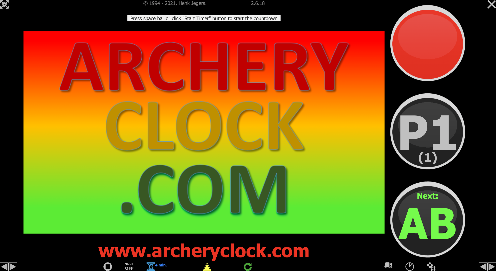
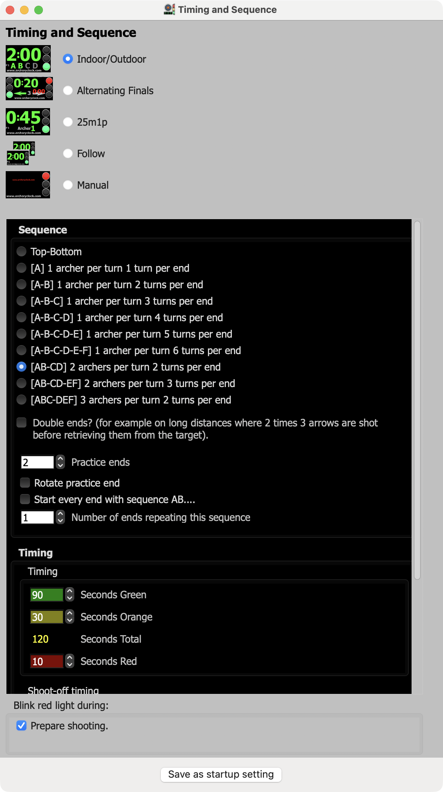
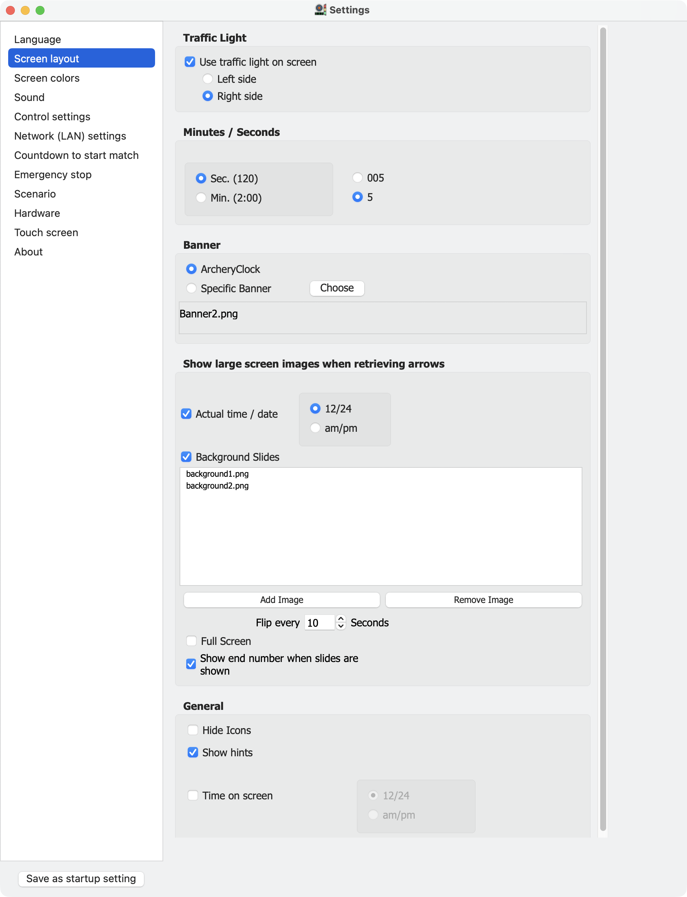
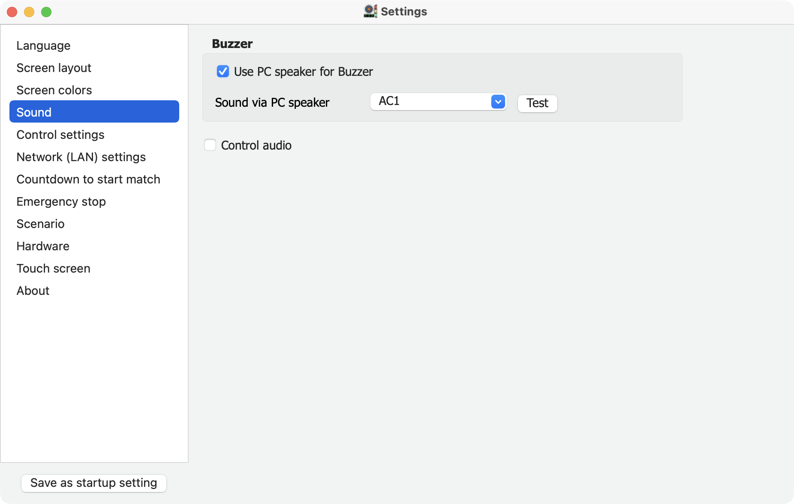
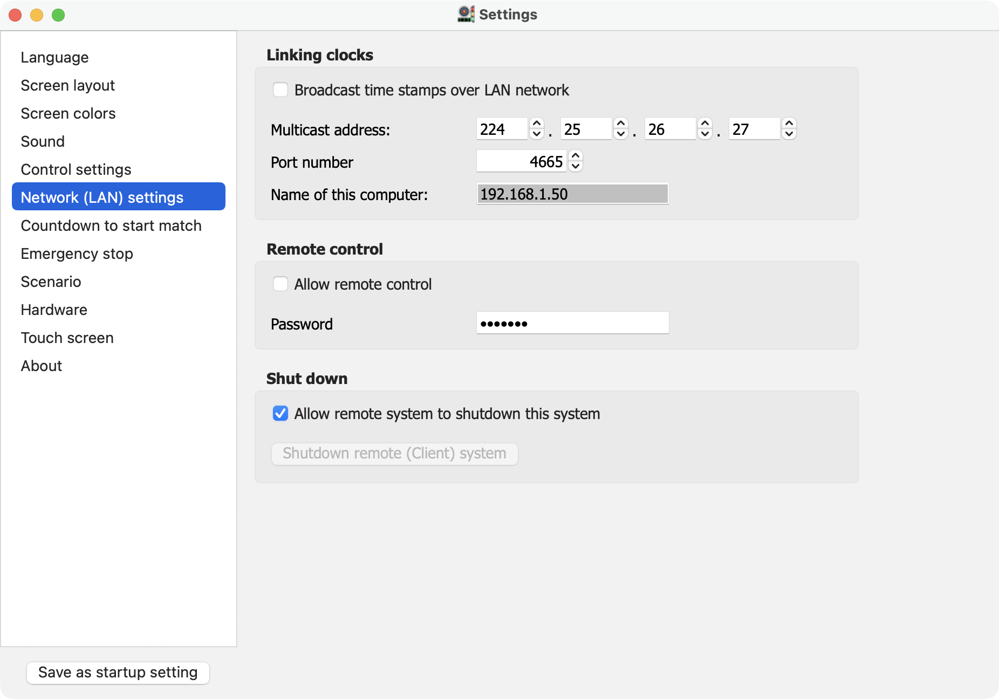
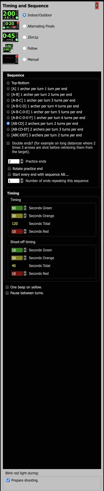
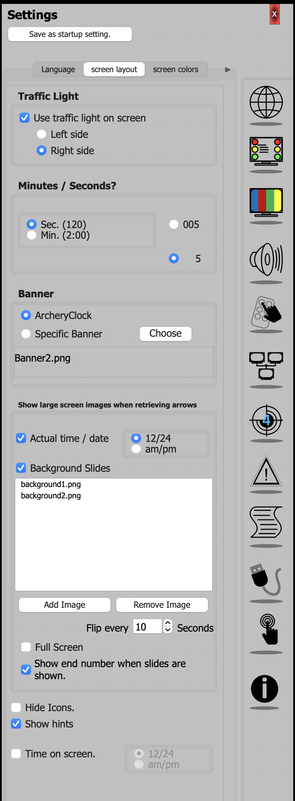
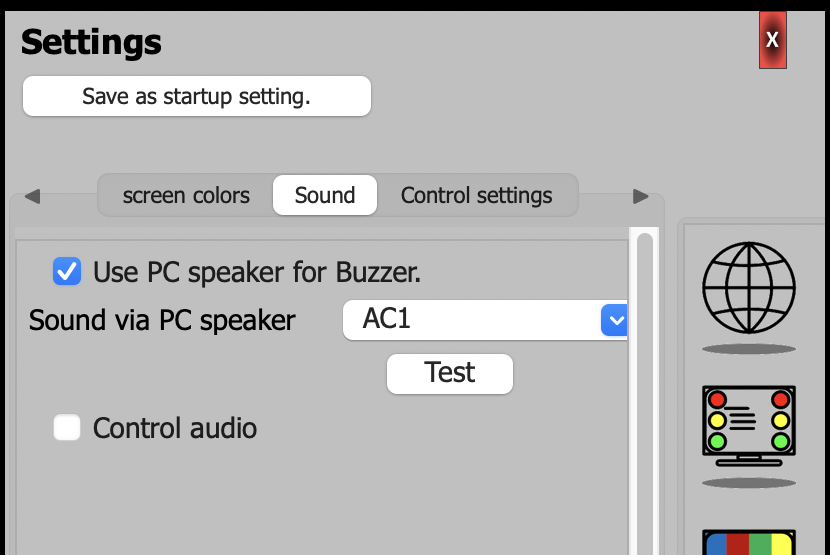
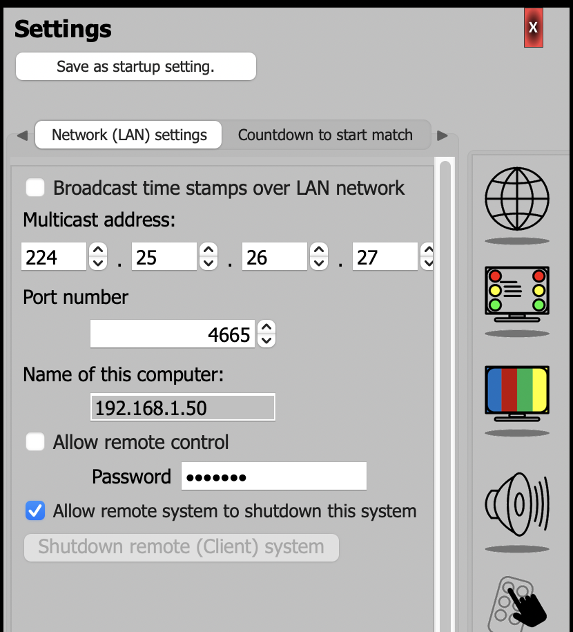

# Archery Clock for Mac

A Mac version of [Archery Clock](http://www.archeryclock.com), the countdown timer used at archery matches.

Archery Clock is written by Henk Jegers, who makes the Windows and Linux versions available at
[archeryclock.com](http://www.archeryclock.com). This Mac version was ported from his 2.6.18. It runs natively on
Apple silicon and Intel Macs (macOS 11 or later), with no Wine, CrossOver or external monitor needed.

Archery Clock is free software under the GNU General Public License version 3 (`COPYING.txt`). This repository
holds the full source of the Mac version: Henk Jegers' 2.6.18 source plus the Mac changes. The changes are kept
apart (`{$IFDEF Darwin}` and the `include/mac*.pas` units), so the Windows and Linux builds are unchanged.

## Two versions

| App | Branch | What it is |
|---|---|---|
| Archery Clock Mac Modern | `mac-redesign` | Timing and Sequence, and Settings, in their own Mac windows; a sidebar of sections; pages laid out the Mac way |
| Archery Clock Mac Classic | `mac-tidy` | The author's single settings panel, as in the Windows version, tidied for the Mac |

Both run on Apple silicon and Intel Macs, and both read and save the same settings
(`~/Library/Application Support/Archery Clock`), so moving from one to the other keeps everything.

## Screenshots

The clock screen (the same in both versions):



Archery Clock Mac Modern: Timing and Sequence, then the Screen layout, Sound and Network pages of Settings:






Archery Clock Mac Classic: the same, in the panel beside the clock as on Windows:






## Install

Download a disk image from Releases and drag the app to Applications. It is not signed with a paid
Apple developer certificate, so the first time: open it, click Done, then System Settings > Privacy &
Security > Open Anyway.

**Choosing a display:** with more than one display connected (a projector or TV for the archers, say), the
clock asks at start which one to show the clock on. Tick "Remember my choice" and it opens there without asking
whenever that display is connected; if it isn't, the clock asks again. Hold Option while opening the clock to be
asked again. With a single display there is no question: the clock opens on it.

Support: the feedback address on [archeryclock.com](http://www.archeryclock.com); see below for what to send.

## Settings, problems and starting over

Everything the app saves is in `~/Library/Application Support/Archery Clock`: the settings, the scenarios, the
list of background slides, the window positions and the remembered display. Errors the clock reports are also
written to `~/Library/Logs/ArcheryClock.log`.

To open either location: in Finder choose Go > Go to Folder (Shift-Command-G) and paste the path.

**Reporting a problem:** email the feedback address on [archeryclock.com](http://www.archeryclock.com), say
what you did and what happened, and attach `ArcheryClock.log` if it exists. Open the log first if you like: it is
plain text, and an error message can name a file on your Mac.

**Starting over:** quit the clock and move the `Archery Clock` folder in Application Support to the Bin (Trash). The
next time the clock opens it starts with the default settings. Saved scenarios and the slide list go
with it, so keep a copy of the folder if you may want them back. To be asked again which display to use,
without resetting anything else, hold Option while opening the clock.

## Languages

The clock's own text comes from the author's `language/` files. The few words the Mac code adds (section
headings, hints, the display question) are in `language/mac/<language>`, one `Key=text` line each; a missing
file or key falls back to English.

## Building

- Free Pascal 3.2.2 (`brew install fpc`).
- Lazarus (fixes_4 branch), built from source, with the two LCL Cocoa fixes in `mac/lazarus-patches/`:
  - `lcl-cocoa-fullscreen-mask.patch`: AppKit throws when a window's full-screen bit is cleared outside a
    full-screen transition (leaving full screen crashed the app).
  - `lcl-cocoa-tab-arrows.patch`: the tab row's scroll arrows did nothing.
- Packages LNet, Synapse 40.1 and Sdpo (Lazarus Online Package Manager).

```
lazbuild --ws=cocoa --cpu=aarch64 --os=darwin --opt=-k-ld_classic archeryclock26.lpi
```

`-k-ld_classic`: Apple's current linker rejects FPC 3.2.2's Objective-C method lists.

For Intel, build the same source with the x86_64 compiler from the official Free Pascal 3.2.2 Mac installer
(`--cpu=x86_64 --compiler=<ppcx64>`, with `-XR<macOS SDK>` and `-WM11.0` in its `fpc.cfg`).
`mac/make-release.sh "Archery Clock Mac Modern" <bundle id> [<x86_64 build>]` packages the app and a disk image; given
the Intel build too, it makes one universal app.
